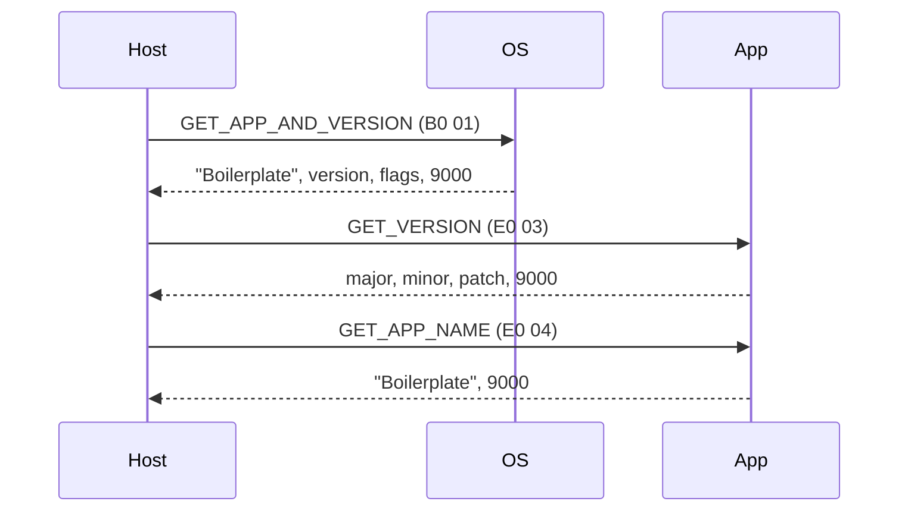
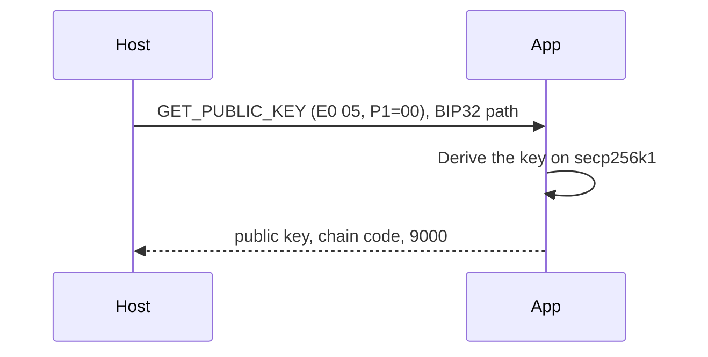
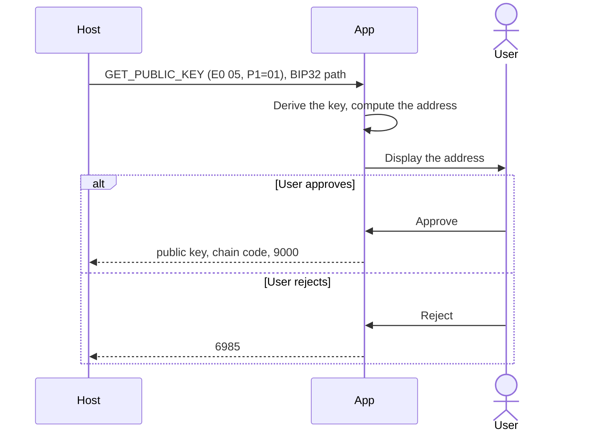
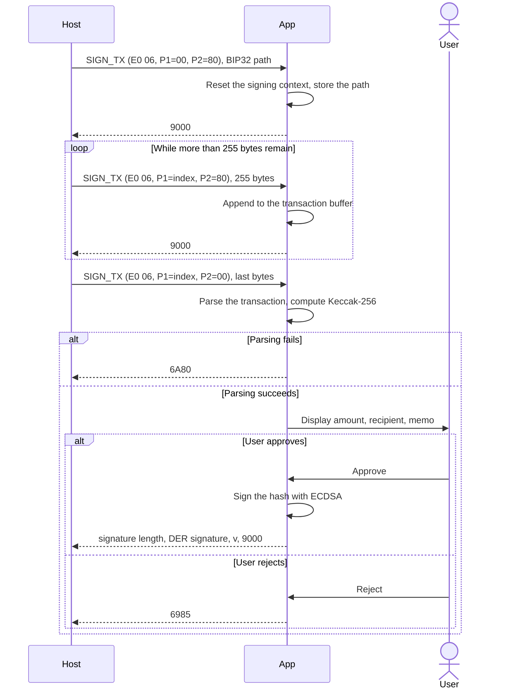
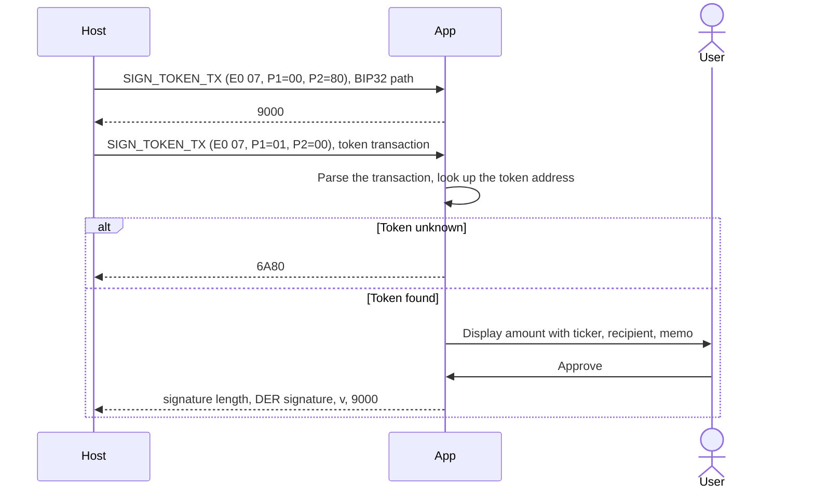
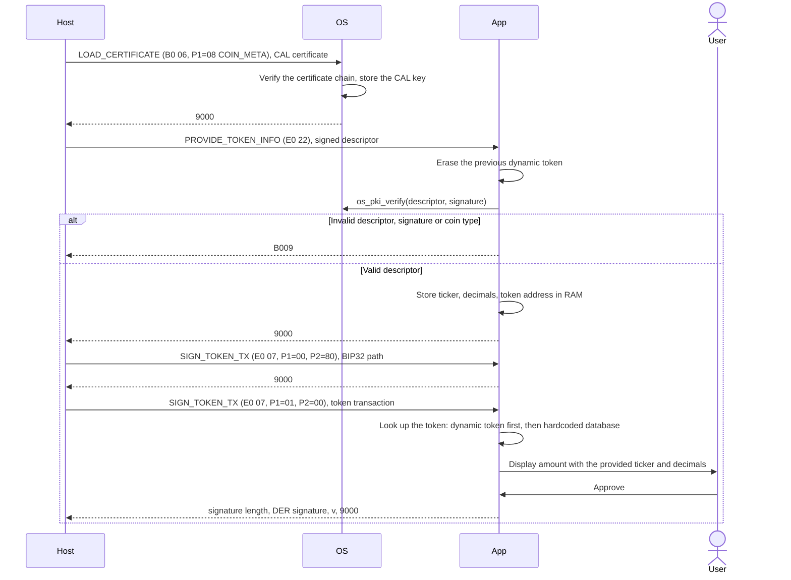
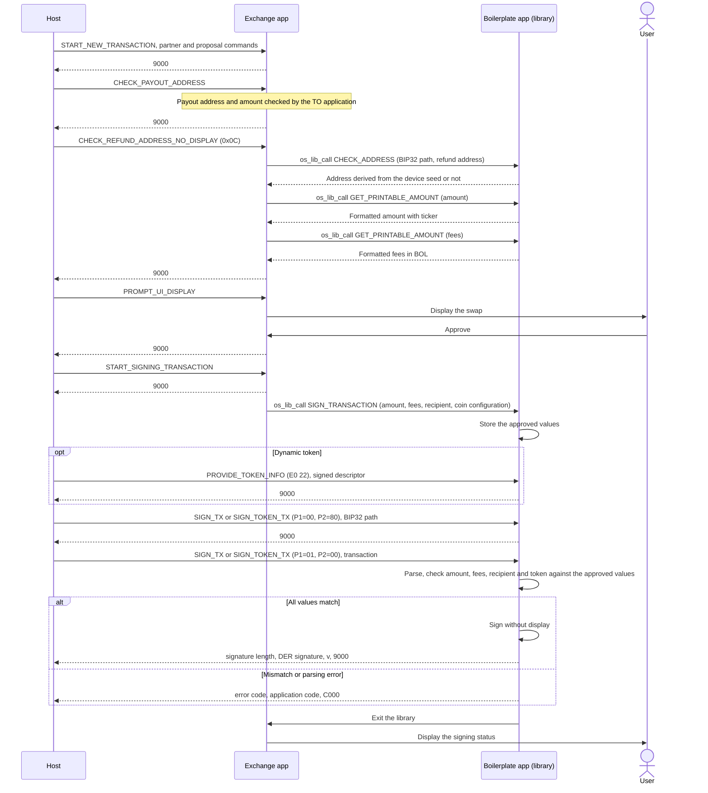
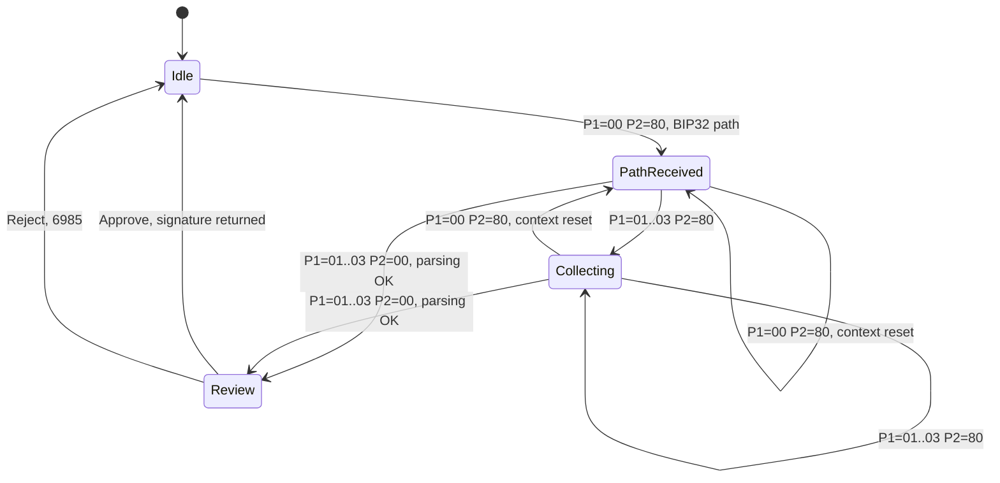

# APDU Flows

> **Warning**
This documentation is a template and shall be updated with your own flows.

This document is the **dynamic** description of the Boilerplate application: for each feature, which APDUs the
host sends, in which order, and how the application and the user react.

The encoding of each command is not repeated here, it is described in the **static** companion document:
[APDU.md](APDU.md).

- [Conventions](#conventions)
- [Identify the application](#identify-the-application)
- [Get a public key](#get-a-public-key)
- [Verify an address on the device](#verify-an-address-on-the-device)
- [Sign a transaction](#sign-a-transaction)
- [Sign a token transaction](#sign-a-token-transaction)
- [Sign a token transaction with a dynamic token](#sign-a-token-transaction-with-a-dynamic-token)
- [Swap](#swap)
- [Signing context lifecycle](#signing-context-lifecycle)

## Conventions

The diagrams use the following participants:

| Participant | Description |
| --- | --- |
| Host | The software driving the device: Ledger wallet, the Device Management Kit, or the Python client in `tests/` |
| OS | BOLOS, for the commands with `CLA = 0xB0` |
| App | The Boilerplate application |
| User | The person reviewing the screens and approving or rejecting on the device |

The APDU traces are written as `=>` for a command sent by the host and `<=` for the response of the device.
They use the path `m/44'/1'/0'/0/0`. Bytes between `<` and `>` depend on the device seed or on a signature.

## Identify the application

Before any other command, the host checks that the expected application is open and that its version
supports the features it needs.



```text
=> b0 01 00 00 00
<= 01 0b 426f696c6572706c617465 <version length> <version> <flags length> <flags> 9000
=> e0 03 00 00 00
<= <major> <minor> <patch> 9000
=> e0 04 00 00 00
<= 426f696c6572706c617465 9000
```

## Get a public key

The host retrieves the public key silently, for example to build the account and its addresses. No screen is
displayed.



```text
=> e0 05 00 00 15 058000002c80000001800000000000000000000000
<= 41 04<64 bytes> 20 <32 bytes> 9000
```

## Verify an address on the device

Before receiving funds, the user checks on the device screen that the address shown by the host is really
derived from their seed.



```text
=> e0 05 01 00 15 058000002c80000001800000000000000000000000
<= 41 04<64 bytes> 20 <32 bytes> 9000      (approved)
<= 6985                                     (rejected)
```

## Sign a transaction

The host sends the BIP32 path first, then the serialized transaction in chunks of at most 255 bytes. The
review starts when the last chunk is received, and the signature is returned only once the user approves.



Trace for a 49-byte transaction (nonce 1, value 666 mBOL, memo `For u EthDev`), which fits in one chunk:

```text
=> e0 06 00 80 15 058000002c80000001800000000000000000000000
<= 9000
=> e0 06 01 00 31 0000000000000001de0b295669a9fd93d5f28d9ec85e40f4cb697bae000000000000029a0c466f72207520457468446576
<= <signature length> <DER signature> <v> 9000
```

A transaction whose memo is exactly `Blind-sign` is displayed with the blind signing flow instead of the
regular review: this is a demonstration of the blind signing screens of the SDK, the APDUs are the same.

## Sign a token transaction

Same flow as [Sign a transaction](#sign-a-transaction) with `SIGN_TOKEN_TX`. The token address in the
transaction is looked up in the hardcoded token database (`src/token/token_db.c`) to display the amount with
the right ticker and decimals.



Trace for a transfer of 1000000 units of the hardcoded `USDC` token (12 decimals), memo `Token test`:

```text
=> e0 07 00 80 15 058000002c80000001800000000000000000000000
<= 9000
=> e0 07 01 00 4f 0000000000000001de0b295669a9fd93d5f28d9ec85e40f4cb697bae0123456789abcdef0123456789abcdef0123456789abcdef0123456789abcdef00000000000f42400a546f6b656e2074657374
<= <signature length> <DER signature> <v> 9000
```

## Sign a token transaction with a dynamic token

When the token is not in the hardcoded database, or to override its metadata, the host provides a descriptor
signed by the Ledger CAL before the transaction. The OS must first know the CAL key: the host loads its
certificate, then sends the descriptor, then the transaction.



```text
=> b0 06 08 00 <length> <CAL certificate>
<= 9000
=> e0 22 00 00 <length> 010190 020101 03028001 040b426f696c6572706c617465 050455534454 060106 0722 1020<32 bytes> 08<length><DER signature>
<= 9000
=> e0 07 00 80 15 058000002c80000001800000000000000000000000
<= 9000
=> e0 07 01 00 4f <token transaction with the same 32-byte token address>
<= <signature length> <DER signature> <v> 9000
```

The dynamic token stays in RAM until the application exits: the host does not need to resend it for each
transaction with the same token. Only one token is kept at a time.

## Swap

In a swap, the user reviews and approves the whole operation in the Exchange application. Exchange then starts
the Boilerplate application as a library to sign the transaction that sends the funds, without displaying it
again: the application only checks that the transaction matches what the user approved.

The commands sent to Exchange are only summarized here, they are described in the
[Exchange documentation](https://ledgerhq.github.io/app-exchange/).

Boilerplate is the FROM application here: the coin that is sent. The payout address and amount are checked
in the same way by the TO application.



The application signs at most one transaction per swap, and exits after the first response.

On failure, the response data holds 2 bytes before the `C000` status word:

| Common error code | Application code | Reason |
| --- | --- | --- |
| `01` | `00` | Amount differs from the approved one |
| `01` | `01` | Token ticker or decimals differ from the approved ones |
| `02` | `00` | Recipient differs from the approved one |
| `03` | `00` | Fees differ from the approved ones |
| `04` | `00` | Native transaction received for a token swap, or the reverse |
| `FF` | `00` | Transaction cannot be parsed, unknown token, or swap not initialized |

## Signing context lifecycle

`SIGN_TX` and `SIGN_TOKEN_TX` share one signing context. Whatever the current state, a first chunk
(`P1 = 0x00`) resets it.



After an error status word, the host must restart the transaction from the first chunk. `GET_PUBLIC_KEY`
also resets the signing context: it must not be sent between two chunks of a transaction.
